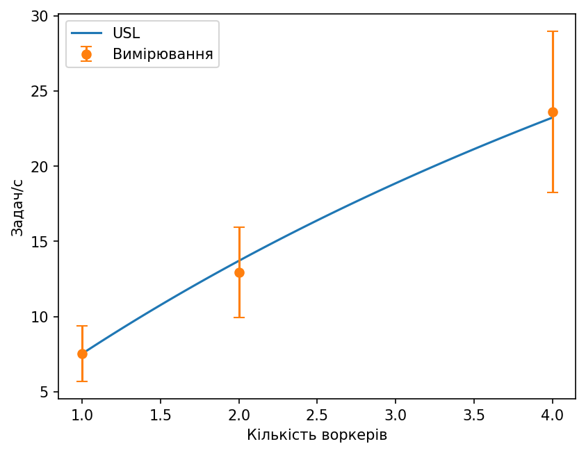
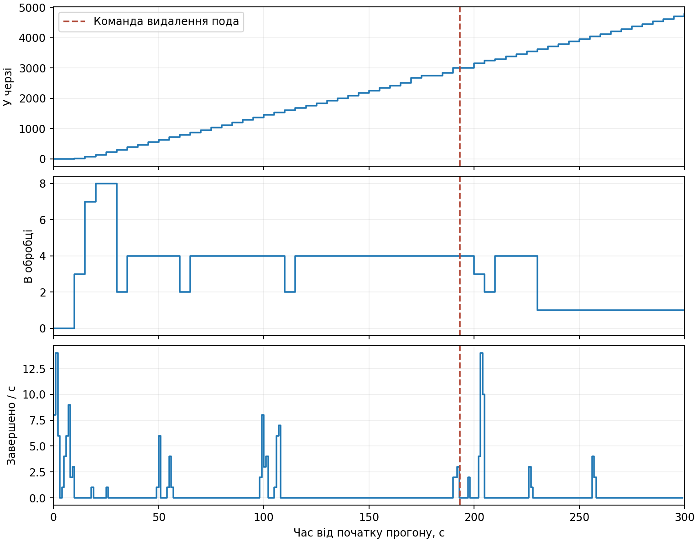

# Лабораторна робота 4. Синхронізація пула воркерів

Варіант 7. Дьяченко Валерія, група ЗК-61мп.

## Мета роботи

Перевірити, як кілька воркерів працюють зі спільною чергою задач, як змінюється швидкість обробки та що відбувається після зупинки воркера.

## Стенд і порядок запуску

Сервіс записів про вакцинацію доповнено чергою PostgreSQL та окремим Deployment воркерів. Зріз 256 × 256 генерується з seed; яскравість перетворюється за квантилями 0,02 і 0,98. Для чотирьох воркерів використано опитування 10 мс, lease 10 с і не більше трьох захоплень після відмов. У захищеному режимі захоплення використовує SKIP LOCKED, heartbeat перевіряє токен і чинність lease, а завершення і запис результату виконуються в одній транзакції.

API приймає задачі через `POST /vaccinations/{id}/tasks` і повертає їхній стан через `GET /tasks/{id}`. Результат зберігається окремо; у захищеному режимі для однієї задачі можливий лише один збережений результат. Кластер `kind-pr4` розгортається командою `powershell -ExecutionPolicy Bypass -File .\deploy.ps1`, етапи запускаються через `run.ps1`. Під час замірів використовувалися локальні API на порту 8084 і Prometheus на порту 9094.

## 20 задач на одному воркері

Середній час HTTP і запису: 0,039592 с; обробка зрізу: 0,1442 с.

## Захоплення задач

| Режим | Задач | Дублі | D за БД | D за журналом | p99, с | Порожні захоплення | Макс. Lock |
| --- | --- | --- | --- | --- | --- | --- | --- |
| naive-10ms | 300 | 29 | 0,096667 | 0,096667 | 0,0082865 | 3479 | н/д |
| naive-1ms | 300 | 28 | 0,093333 | 0,093333 | 0,0079208 | 18022 | н/д |
| skip-1ms | 300 | 0 | 0 | 0 | 0,007562 | 22156 | н/д |
| blocking-1ms | 300 | 0 | 0 | 0 | 0,0075795 | 20360 | 2 |

Наївні режими дали 9,67 % і 9,33 % задач із дублями. У кожному було по 32 зайві записи результату: для деяких задач результат записано більше двох разів. Після додавання блокування рядків дублів у вибірках не було. Різниця p99 між двома режимами блокування мала: близько 7,56 і 7,58 мс. За одним прогоном не можна стверджувати, що один режим стабільно швидший.

Лічильники Prometheus прив’язані до моментів збору; короткі очікування блокування могли не потрапити у вибірку.

## SIGSTOP на 20 секунд

Задача 1448: attempts 1 → 2, token 1 → 2. Завершив worker-7dcfc6f986-7rpfp. Результатів: 1. Рядок журналу:

```json
{"event": "lost", "worker_id": "worker-7dcfc6f986-jx59v", "task_id": 1448, "token": 1, "updated_rows": 0, "t_io": 0.10841026199977932, "t_cpu": 21.090313853000225}
```

Після закінчення lease задачу взяв інший воркер і записав результат із токеном 2. Коли зупинений воркер відновився, його запит із токеном 1 оновив 0 рядків. Усі 100 задач завершилися, і для задачі 1448 залишився один результат.

## Пропускна здатність

| Воркери | X, задач/с | Розкид | Вікно, с | p99 захоплення, с | Транзакцій/с | CPU БД, ядер | C |
| --- | --- | --- | --- | --- | --- | --- | --- |
| 1 | 7,5333 | 1,8333 | 30 | 0,0078877 | 43,514 | 0,12825 | 1 |
| 2 | 12,933 | 3,005 | 30 | 0,02149 | 46,633 | 0,11957 | 1,7168 |
| 4 | 23,625 | 5,3526 | 16 | 0,038909 | 62,472 | 0,15976 | 3,1361 |

У частині прогонів 400 задач завершилися швидше ніж за 30 с. Використано лише повні секунди між початком роботи і спорожненням черги; ці оцінки є наближеними.

Оцінка 1/(t_io + t_cpu + T_poll/2): 5,2969 задач/с; виміряне X(1): 7,5333.

σ = 0,09914, κ = 0, W* = скінченного максимуму немає.

Перехід від одного до чотирьох воркерів підвищив пропускну здатність у 3,14 раза. Формульна оцінка X(1) побудована за окремим прогоном 20 задач, тому її не можна вважати точною оцінкою насиченої черги. Значення транзакцій і CPU усереднені за доступними точками Prometheus протягом прогону; їхнє вікно не збігається точно з вікном X.



## Закон Літтла

| λ | Wq, с | Lq | λ × Wq | Розбіжність, % |
| --- | --- | --- | --- | --- |
| 16,533 | 0,090449 | 1,5417 | 1,4954 | 2,9995 |

За навантаження 0,7 · X(4) виміряне середнє число задач у черзі (1,542) близьке до розрахункового (1,495). Відносна розбіжність становить 3,00 % від виміряного Lq. Наприкінці подачі задач у черзі не залишилося.

## Перевантаження

| Черга наприкінці | Wq перших 100, с | Wq останніх 100, с |
| --- | --- | --- |
| 651 | 0,24769 | 33,642 |

За 1,3 · X(4) було прийнято 3686 задач. Наприкінці 120 секунд у черзі залишилася 651 задача. Середній час очікування останніх 100 задач зріс приблизно зі 0,25 до 33,64 с порівняно з першими 100.

## Коректна зупинка

Під навантаженням було виконано послідовний перезапуск Deployment. Стани старих контейнерів перевірялися під час перезапуску.

| Pod | Код завершення | Стан |
| --- | ---: | --- |
| worker-597cc67bd6-6lmml | 0 | CONTAINER_EXITED |
| worker-597cc67bd6-nj6f8 | 0 | CONTAINER_EXITED |
| worker-597cc67bd6-nr5mb | 0 | CONTAINER_EXITED |
| worker-597cc67bd6-vdkph | 0 | CONTAINER_EXITED |

| Прийнято | Завершено | Повернуто | Failed | Дублі | Attempts > 1 |
| ---: | ---: | ---: | ---: | ---: | ---: |
| 2977 | 2977 | 0 | 0 | 0 | 0 |

Усі чотири старі контейнери завершилися з кодом 0. Кожна прийнята задача була виконана з першої спроби й мала один збережений результат. У цьому прогоні не зафіксовано повернення задач у чергу.

## Ф1. Видалення пода і випадкові відмови

Подача тривала 300 с із заданою інтенсивністю 16,5375 задачі/с. Прийнято 4962 задачі. Під час подачі було ввімкнено випадкові відмови з імовірністю 0,15. На 193,22 с від початку прогону под `worker-66ccdff455-xm9dn` було примусово видалено. Перед видаленням процес воркера призупинили й перевірили, що за ним закріплена задача з чинним lease.

| Показник | Знімок після подачі, до вимкнення збоїв | Після розбору черги з вимкненими збоями |
| --- | ---: | ---: |
| Завершено | 146 | 4962 |
| Failed | 0 | 0 |
| У черзі | 4815 | 0 |
| В обробці | 1 | 0 |
| Задач із повторним захопленням | 21 | 23 |
| Дублі результатів | 0 | 0 |

У межах 300 с завершено 146 задач: **0,487 задачі/с** проти **23,625 задачі/с** у короткому прогоні насиченої черги на чотирьох воркерах без відмов. Для чотирьох подів, наявних на момент знімка, зафіксовано 5, 3, 5 і 5 перезапусків (разом 18). Ця сума не включає історію видаленого пода. Більшість задач залишилася в черзі до вимкнення збоїв.

Після розбору черги кількість задач із 1, 2 і 3 спробами становила відповідно 4939, 17 і 6. Частка повторних захоплень — 0,464 %, частка failed — 0 %. Для незалежних відмов з імовірністю 0,15 на кожній спробі теоретичні частки становлять 15 % і 0,3375 % відповідно. Це інші умови: більшість задач у цьому прогоні виконано після вимкнення збоїв.

| Задача | Залишок lease при команді видалення, с | До запису `expired`, с | До завершення, с | Спроби | Токен | Воркер, що завершив | Результатів |
| --- | ---: | ---: | ---: | --- | --- | --- | ---: |
| 25869 | 9,21 | 9,48 | 9,66 | 1 → 2 | 1 → 2 | worker-66ccdff455-sqz5r | 1 |

На момент команди видалення lease задачі 25869 ще діяв. Після його спливу було зафіксовано подію `expired` зі старим токеном. Інший воркер забрав ту саму задачу з токеном 2 і записав один результат. Час відраховано від команди видалення пода.



## Д2. Відкладений запуск

| Задачі | p50, с | p99, с | Запущено раніше |
| --- | --- | --- | --- |
| 100 | 0,003381 | 0,010437 | 0 |
За 100 задачами p50 затримки від запланованого часу склав 3,381 мс, p99 — 10,437 мс. Жодна задача не стартувала раніше свого `run_after`.

## Висновок

Блокування рядків прибрало дублікати в обох захищених прогонах. Перевірка SIGSTOP показала, що після закінчення lease інший воркер може забрати задачу, а старий токен не дає перезаписати результат. Чотири воркери обробляли задачі приблизно втричі швидше за одного, але в серії з відмовами швидкість за п'ять хвилин різко впала й більшість задач залишилася в черзі. За стабільного навантаження закон Літтла виконався з розбіжністю близько 3 %, а в режимі відкладеного запуску ранніх стартів не виявлено.
